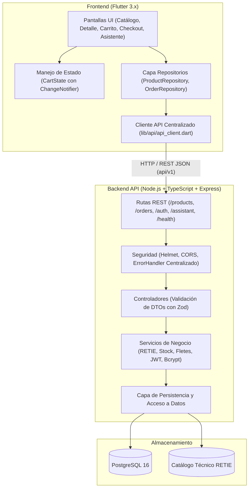

# Electro Industrial — App de Compra y Venta de Materiales Eléctricos e Industriales

[-success)](backend/tests/)
[](backend/)
[](frontend/)
[](docs/ARCHITECTURE.md)
[](docs/openapi.yaml)
[](docs/)

Plataforma integral de comercio electrónico B2B y B2C especializada en materiales, conductores y herramientas eléctricas en Colombia, con catálogo certificado bajo normativas técnicas obligatorias **RETIE** (Reglamento Técnico de Instalaciones Eléctricas) y **NTC 2050**.

---

## 🏛️ Topología y Arquitectura del Sistema

El proyecto está organizado como un **Monorepo Desacoplado** con separación estricta de responsabilidades entre el cliente y el servidor:



---

## 📂 Estructura de Directorios

```
app-compra-venta-electricos/
├── backend/                      # Servidor API REST independiente
│   ├── src/
│   │   ├── config/               # Variables de entorno tipadas (JWT_SECRET, JWT_EXPIRES_IN)
│   │   ├── controllers/          # Controladores HTTP y respuestas
│   │   ├── data/                 # Catálogo técnico RETIE (seed)
│   │   ├── middlewares/          # Helmet, CORS, ErrorHandler, Auth JWT
│   │   ├── models/               # DTOs, Zod schemas y entidades
│   │   ├── repositories/         # Capa de persistencia (incluye seed de usuarios)
│   │   ├── routes/               # Rutas versionadas /api/v1
│   │   └── services/             # Lógica de negocio (stock, fletes, auth, JWT, bcrypt)
│   ├── tests/                    # 37 pruebas de integración, seguridad y auth
│   ├── docker-compose.yml        # PostgreSQL 16 local
│   ├── Dockerfile                # Imagen de producción multi-stage
│   └── package.json
├── frontend/                     # Aplicación cliente Flutter desacoplada
│   ├── lib/
│   │   ├── api/                  # ApiClient con interceptor 401 y token Bearer
│   │   ├── models/               # Entidades Product, AppUser con fromJson/toJson
│   │   ├── repositories/         # Consumo API con fallback offline
│   │   ├── screens/              # UI responsiva (Home, Detail, Cart, Checkout, Login, SessionInfo)
│   │   ├── services/             # TokenStorageService (flutter_secure_storage)
│   │   ├── state/                # AppState reactivo con auth JWT
│   │   └── theme/                # Paleta industrial 60/30/10 WCAG AA
│   ├── test/                     # 80 pruebas unitarias y de widgets
│   ├── analysis_options.yaml     # Reglas de linter estrictas (0 issues)
│   └── pubspec.yaml
├── docs/                         # Documentación técnica y contratos
│   ├── ARCHITECTURE.md           # Diseño arquitectónico detallado
│   ├── PLAN.md                   # Plan maestro y trazabilidad de PRs
│   └── openapi.yaml              # Especificación OpenAPI 3.0.3
├── AGENTS.md                     # Estándares obligatorios de ingeniería
└── README.md                     # Este portal
```

---

## 🚀 Inicio Rápido (Desarrollo Local)

### 1. Prerrequisitos
- **Node.js**: v18+ y `npm`
- **Flutter SDK**: v3.x+
- **Docker** y **Docker Compose** (opcional, para PostgreSQL)

### 2. Configuración de Entorno
```bash
# En la raíz del repositorio
cp .env.example .env
```

Editar `.env` con los valores requeridos:
```env
JWT_SECRET=tu_clave_secreta_segura_aqui    # Clave de firma para JWT (obligatoria)
JWT_EXPIRES_IN=24h                          # Tiempo de expiración del token
PORT=3000                                   # Puerto del servidor
NODE_ENV=development
```

> ⚠️ **Nunca** subas el archivo `.env` al repositorio. Ya está protegido en `.gitignore`.

### 3. Ejecutar el Backend (Node.js + Express)
```bash
cd backend
npm install
npm run dev
```
- API Base: `http://localhost:3000/api/v1`
- Verificación de salud: `http://localhost:3000/api/v1/health`

### 4. Ejecutar el Frontend (Flutter)
```bash
cd frontend
flutter pub get
flutter run
```

---

## 🧪 Pruebas Automatizadas y Calidad

El proyecto cuenta con **117 pruebas automatizadas** que cubren unitarias, integración, seguridad, auth JWT y widgets:

### En el Backend:
```bash
cd backend
npm run lint           # Verificación de tipos TypeScript (0 errores)
npm run build          # Compilación a dist/
npm test               # 37 pruebas pasadas (100%)
npm run test:coverage  # Cobertura superior al 90%
```

### En el Frontend:
```bash
cd frontend
flutter analyze        # Análisis estático (0 issues)
flutter test           # 80 pruebas unitarias y de widgets pasadas (100%)
```

---

## 🔐 Autenticación JWT

El sistema implementa autenticación completa con JSON Web Tokens:

### Usuarios de prueba (seed)

| Correo | Contraseña | Rol |
|--------|-----------|-----|
| `admin@electroindustrial.com` | `Admin2026*` | admin |
| `demo@electroindustrial.com` | `Demo2026*` | customer |

### Endpoints de autenticación

| Método | Endpoint | Protegido | Descripción |
|--------|----------|-----------|-------------|
| `POST` | `/api/v1/auth/register` | ❌ | Registrar nuevo usuario |
| `POST` | `/api/v1/auth/login` | ❌ | Iniciar sesión (devuelve JWT) |
| `GET` | `/api/v1/auth/me` | ✅ | Perfil del usuario autenticado |

### Protección de endpoints

| Recurso | GET (listar) | GET (detalle) | POST | PUT | DELETE |
|---------|:---:|:---:|:---:|:---:|:---:|
| Productos | 🔓 Público | 🔓 Público | 🔒 JWT | 🔒 JWT | 🔒 JWT |
| Órdenes | — | 🔒 JWT | 🔒 JWT | — | — |
| Tracking | 🔓 Público | — | — | — | — |
| Health | 🔓 Público | — | — | — | — |
| Assistant | 🔓 Público | 🔓 Público | — | — | — |

### Ejemplo con curl

```bash
# 1. Login — obtener token
TOKEN=$(curl -s http://localhost:3000/api/v1/auth/login \
  -H "Content-Type: application/json" \
  -d '{"email":"admin@electroindustrial.com","password":"Admin2026*"}' \
  | python3 -c "import sys,json; print(json.load(sys.stdin)['data']['token'])")

# 2. Acceder a endpoint protegido (con token)
curl -s http://localhost:3000/api/v1/auth/me \
  -H "Authorization: Bearer $TOKEN" | python3 -m json.tool

# 3. Intentar sin token (debe devolver 401)
curl -s -o /dev/null -w "%{http_code}" \
  http://localhost:3000/api/v1/orders -X POST \
  -H "Content-Type: application/json" \
  -d '{"items":[{"productId":1,"quantity":1}]}'
# Respuesta: 401
```

### En el cliente Flutter

- **Login**: pantalla con estados de carga, error y éxito
- **Token**: almacenado con `flutter_secure_storage` (encriptado en keychain/keystore)
- **Interceptor 401**: limpia sesión y redirige al login automáticamente
- **Persistencia**: al abrir la app, verifica si hay token válido guardado
- **Pantalla de sesión**: muestra nombre, correo, rol, estado y preview del token

---

## 📜 Contratos y Documentación Técnica

- [**`docs/ARCHITECTURE.md`**](docs/ARCHITECTURE.md): Documento de diseño arquitectónico y diagramas Mermaid.
- [**`docs/openapi.yaml`**](docs/openapi.yaml): Especificación OpenAPI 3.0.3 completa.
- [**`docs/PLAN.md`**](docs/PLAN.md): Plan maestro de 6 fases y Pull Requests.
- [**`AGENTS.md`**](AGENTS.md): Reglas de ingeniería, seguridad y flujo Git.

---

## 🌿 Trazabilidad de Pull Requests

El proyecto fue desarrollado y entregado mediante un flujo de trabajo de equipo real con Conventional Commits:

1. [**PR #2: `chore: configuracion inicial de estandares, reglas de agentes y documentacion`**](https://github.com/Santi202305/app-compra-venta-electricos/pull/2)
2. [**PR #3: `refactor(backend): inicializar paquete backend con arquitectura en capas, express, typescript y tests`**](https://github.com/Santi202305/app-compra-venta-electricos/pull/3)
3. [**PR #4: `refactor(frontend): migrar aplicacion flutter a frontend, corregir linter y pruebas unitarias`**](https://github.com/Santi202305/app-compra-venta-electricos/pull/4)
4. [**PR #5: `feat: conectar frontend a api rest, implementar auth con jwt y gestion de ordenes`**](https://github.com/Santi202305/app-compra-venta-electricos/pull/5)
5. [**PR #6: `test: incorporar pruebas de seguridad en backend y pruebas unitarias/widgets en frontend`**](https://github.com/Santi202305/app-compra-venta-electricos/pull/6)
6. [**PR #7: `docs: documentacion final de arquitectura, dockerfile y cierre de ingenieria`**](https://github.com/Santi202305/app-compra-venta-electricos/pull/7)
7. [**PR #8: `feat: autenticacion JWT completa (backend + frontend)`**](https://github.com/Santi202305/app-compra-venta-electricos/pull/8)
