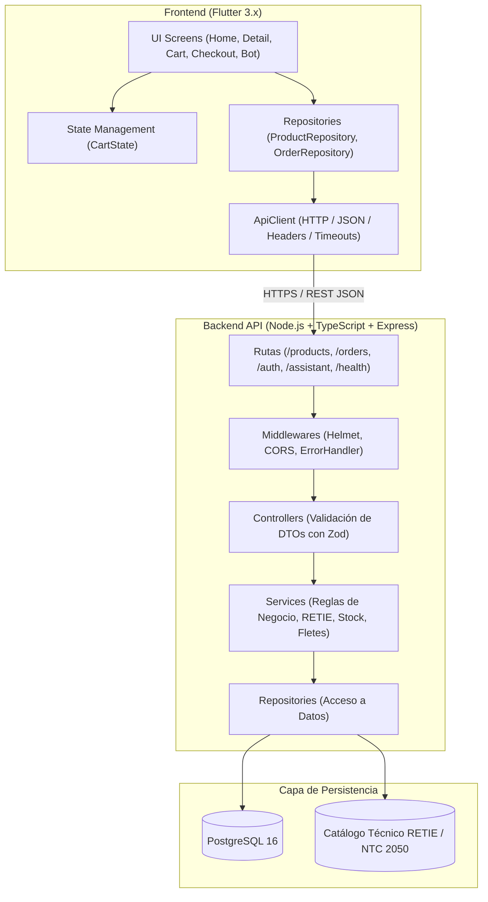

# Arquitectura del Sistema — Electro Industrial

Documento técnico de diseño de arquitectura para la plataforma de compra y venta de materiales eléctricos e industriales ("Electro Industrial").

---

## 1. Visión General y Topología

La solución adopta un patrón **Monorepo Desacoplado** con separación estricta entre la aplicación cliente y los servicios de backend:

---

## 2. Capas del Backend (`/backend`)

La arquitectura sigue los principios de Clean Architecture y Separación de Responsabilidades:

1. **Rutas (`src/routes/`):**
   - Mapeo de verbos HTTP y endpoints semánticos.
   - Enlace directo a controladores.
2. **Controladores (`src/controllers/`):**
   - Parseo y saneamiento de payloads mediante esquemas **Zod**.
   - Respuestas HTTP con códigos de estado estandarizados (200, 201, 400, 401, 404, 500).
   - Sin acceso directo a bases de datos ni lógica de cálculo.
3. **Servicios (`src/services/`):**
   - **`ProductService`**: Búsqueda por texto, filtrado de categorías y verificación de inventario.
   - **`OrderService`**: Deducción de stock atómica, cálculo de flete nacional ($12.000 COP) y generación de códigos de guía (`ELC-YYYYMMDD-XXXX`).
   - **`AuthService`**: Hash de contraseñas con `bcrypt` (10 rondas de salt) y firma de tokens JWT (24h).
   - **`AssistantService`**: Base de conocimiento para preguntas frecuentes (horarios, envíos, garantías RETIE).
4. **Repositorios (`src/repositories/`):**
   - Persistencia parametrizada y consultas a PostgreSQL 16.
   - Soporte para catálogos iniciales en memoria con tolerancia a caídas de red.

---

## 3. Capas del Frontend (`/frontend`)

1. **Presentación (`lib/screens/`, `lib/widgets/`):**
   - Pantallas desacopladas: Catálogo, Detalle, Carrito, Checkout, Asistente Bot, Login.
   - Paleta corporativa industrial 60/30/10 con contraste accesible (WCAG AA).
2. **Estado Reactivo (`lib/state/`):**
   - `CartState` (`ChangeNotifier`) para administración centralizada de items, subtotales y cantidades.
3. **Capa de Abstracción de Datos (`lib/repositories/`):**
   - `ProductRepository`: Obtiene productos de la API con fallback seguro al catálogo local si no hay conexión.
   - `OrderRepository`: Envía checkout a la API y genera trazabilidad local ante fallos de conectividad.
4. **Capa Cliente API (`lib/api/`):**
   - `ApiClient`: Singleton HTTP con interceptores de autenticación Bearer, timeouts de 10s y conversión a excepciones tipadas `ApiException`.

---

## 4. Matriz de Endpoints de la API REST

| Método | Endpoint | Descripción | Autenticación |
| :--- | :--- | :--- | :--- |
| `GET` | `/api/v1/health` | Estado de salud del servicio y uptime | Pública |
| `GET` | `/api/v1/products` | Catálogo con filtros (`category`, `search`, `inStockOnly`) | Pública |
| `GET` | `/api/v1/products/:id` | Detalle técnico y especificaciones RETIE de un producto | Pública |
| `POST` | `/api/v1/auth/register` | Registro de nuevos usuarios y emisión de JWT | Pública |
| `POST` | `/api/v1/auth/login` | Inicio de sesión con verificación de credenciales | Pública |
| `POST` | `/api/v1/orders` | Checkout, deducción de stock y asignación de guía | Pública / Cliente |
| `GET` | `/api/v1/orders/:id` | Consulta de orden por ID interno | Pública / Cliente |
| `GET` | `/api/v1/orders/tracking/:trackingNumber` | Consulta de orden por número de guía | Pública |
| `GET` | `/api/v1/assistant/faq` | Respuestas comerciales del asistente bot | Pública |
| `GET` | `/api/v1/assistant/faq/:key` | Respuesta para consulta específica | Pública |

---

## 5. Medidas de Seguridad Implementadas

- **Protección contra Inyección SQL:** Todas las consultas se procesan parametrizadas o saneadas con tipado estricto.
- **Validación de Entradas:** DTOs validados con Zod en tiempo de ejecución para rechazar campos no autorizados o malformados.
- **Criptografía:** Hash de contraseñas mediante `bcryptjs` con salt rounds de factor 10.
- **Confidencialidad:** Prohibición absoluta de exponer hashes o secretos en respuestas HTTP o repositorios.
- **Cabeceras HTTP Seguras:** Implementación de `helmet` (`nosniff`, `dns-prefetch-control`, supresión de `x-powered-by`).
- **Control de Acceso:** CORS configurable por variable de entorno `CORS_ORIGIN`.
