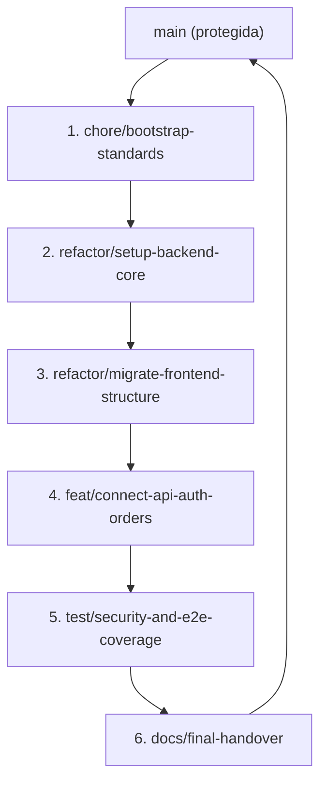

# Plan Maestro de Separación Backend / Frontend y Modernización Arquitectónica
## Repositorio: `app-compra-venta-electricos`

---

## 1. Justificación de Stack y Arquitectura

Tras la auditoría técnica de la Fase 0 y la decisión del Tech Lead:
- **Frontend:** **Flutter 3.x** en `/frontend`. Mantiene la compatibilidad multiplataforma (Móvil, Web y Linux Desktop), el diseño industrial con accesibilidad WCAG AA y la interfaz adaptativa.
- **Backend:** **Node.js (TypeScript) + Express** en `/backend`. Ofrece tipado estricto de extremo a extremo, alta velocidad de desarrollo, consumo mínimo de recursos frente a JVM, y ejecución desacoplada en contenedores Docker.
- **Base de Datos:** **PostgreSQL 16** gestionada con `docker-compose.yml`, con esquema relacional para productos, categorías, usuarios y órdenes de compra, sembrada inicialmente con los 35 productos técnicos certificados bajo normativa RETIE / NTC 2050.
- **Contrato de Comunicación:** **RESTful API** en formato JSON, versionada bajo `/api/v1`, tipada y documentada formalmente en OpenAPI 3.0 (`docs/openapi.yaml`).

---

## 2. Estructura Final de Carpetas Propuesta

```
app-compra-venta-electricos/
├── .github/
│   └── workflows/
│       ├── backend-ci.yml        # Lint, typecheck y tests automáticos en backend
│       └── frontend-ci.yml       # Flutter analyze y flutter test en frontend
├── backend/                      # Paquete independiente del servidor API REST
│   ├── .env.example              # Variables de entorno requeridas (PORT, DB_*, JWT_SECRET)
│   ├── .gitignore
│   ├── package.json
│   ├── tsconfig.json
│   ├── docker-compose.yml        # PostgreSQL 16 + pgAdmin / Adminer local
│   ├── Dockerfile
│   ├── src/
│   │   ├── config/               # Configuración de entorno y conexión DB pool
│   │   ├── controllers/          # Controladores HTTP (manejo de Request/Response)
│   │   ├── middlewares/          # Autenticación JWT, validación de schemas, CORS, logs
│   │   ├── models/               # Definición de entidades, DTOs e interfaces
│   │   ├── repositories/         # Capa de acceso a datos SQL parametrizada
│   │   ├── routes/               # Rutas Express (/products, /auth, /orders, /assistant)
│   │   ├── services/             # Lógica de negocio (cálculo de stock, fletes, pagos)
│   │   ├── data/                 # Seed inicial del catálogo técnico RETIE (35 SKUs)
│   │   └── app.ts / index.ts     # Configuración y arranque del servidor
│   ├── tests/                    # Tests unitarios y de integración con Supertest/Jest
│   └── README.md                 # Guía paso a paso para levantar el backend
├── frontend/                     # Aplicación cliente Flutter desacoplada
│   ├── .env.example              # API_BASE_URL=http://localhost:3000/api/v1
│   ├── analysis_options.yaml     # Reglas de linter estrictas
│   ├── pubspec.yaml
│   ├── lib/
│   │   ├── api/                  # Cliente HTTP, interceptores, DTOs y manejo de errores
│   │   ├── models/               # Modelos de dominio inmutables
│   │   ├── repositories/         # ProductRepository (consumo de API con fallback/cache)
│   │   ├── screens/              # Pantallas responsivas de la app
│   │   ├── state/                # AppState y CartState
│   │   ├── theme/                # Tema industrial 60/30/10 WCAG AA
│   │   └── widgets/              # Widgets reutilizables
│   ├── test/                     # 80+ pruebas unitarias, de widgets y responsivas
│   └── README.md                 # Guía paso a paso para ejecutar el frontend
├── docs/
│   ├── PLAN.md                   # Este plan maestro de arquitectura
│   └── openapi.yaml              # Especificación técnica OpenAPI 3.0 de la API
├── AGENTS.md                     # Estándares obligatorios para agentes y desarrolladores
├── .gitignore                    # Reglas globales de exclusión Git
└── README.md                     # Portal raíz con visión general y quickstart integral
```

---

## 3. Secuencia de Ramas y Pull Requests (Flujo de Trabajo Real)

Para asegurar entregas pequeñas, atómicas, testeables y de bajo riesgo:



### Detalle de los Pull Requests:

#### PR 1: `chore/bootstrap-standards`
- **Propósito:** Establecer los estándares base del repositorio antes de mover código.
- **Archivos tocados:** `.gitignore`, `.env.example`, `AGENTS.md`, `docs/PLAN.md`, `docs/openapi.yaml`.
- **Criterio de terminado:**
  - El token de GitHub no está expuesto en ninguna parte.
  - Reglas de Git y Conventional Commits fijadas en `AGENTS.md`.
  - Especificación OpenAPI 3.0 documentada y validada.
- **Verificación:** `git status` limpio y revisión de sintaxis YAML.

#### PR 2: `refactor/setup-backend-core`
- **Propósito:** Crear la estructura y servidor del `/backend` en TypeScript + Express con PostgreSQL.
- **Archivos tocados:** `/backend/**` (configuración, servidor, rutas de `/products`, seed de 35 productos, `docker-compose.yml`, pruebas de endpoint con Jest/Supertest).
- **Criterio de terminado:**
  - Servidor compila con `tsc` sin errores.
  - `GET /health` responde 200 OK.
  - `GET /api/v1/products` devuelve el catálogo paginado con filtros.
  - Tests unitarios y de integración pasando al 100%.
- **Verificación:** `npm run build && npm test` en `/backend`.

#### PR 3: `refactor/migrate-frontend-structure`
- **Propósito:** Mover el proyecto Flutter actual a `/frontend/`, corregir el test roto y limpiar análisis estático.
- **Archivos tocados:** Mover código a `/frontend/`, corregir `test/product_test.dart`, añadir `analysis_options.yaml`, eliminar imports no usados y resolver deprecaciones.
- **Criterio de terminado:**
  - `flutter analyze` en `/frontend` da **0 problemas**.
  - `flutter test` en `/frontend` pasa al 100%.
  - Estructura limpia y aislada.
- **Verificación:** `cd frontend && flutter analyze && flutter test`.

#### PR 4: `feat/connect-api-auth-orders`
- **Propósito:** Conectar el frontend a la API del backend mediante un cliente HTTP desacoplado.
- **Archivos tocados:**
  - Backend: Endpoints de `/auth/login`, `/auth/register`, `/orders`, validaciones con schemas Zod/DTO.
  - Frontend: `lib/api/api_client.dart`, `ProductRepository` conectado a HTTP con fallback resiliente, sincronización de pedidos y autenticación real.
- **Criterio de terminado:**
  - Login y registro emiten y validan tokens JWT.
  - Checkout envía la orden al backend y descuenta inventario en PostgreSQL.
  - Manejo unificado de errores y estados de carga en UI.
- **Verificación:** Pruebas de integración de flujo completo (Creación de orden vía API + verificación en DB).

#### PR 5: `test/security-and-e2e-coverage`
- **Propósito:** Robustecer seguridad y pruebas de extremo a extremo.
- **Archivos tocados:** Middlewares de seguridad (Helmet, CORS estricto, rate limiting, hashing de contraseñas con bcrypt), tests de inyección SQL, validaciones de esquemas en backend y tests de integración con `MockClient` en Flutter.
- **Criterio de terminado:**
  - Contraseñas nunca en texto plano.
  - Tests de endpoints críticos pasando al 100%.
- **Verificación:** `npm test` en backend y `flutter test` en frontend.

#### PR 6: `docs/final-handover`
- **Propósito:** Documentación final y portal raíz.
- **Archivos tocados:** `README.md` principal, `/backend/README.md`, `/frontend/README.md`, manual de despliegue con Docker y diagramas de arquitectura actualizados.
- **Criterio de terminado:**
  - Documentación completa con instrucciones exactas de ejecución en 1 solo comando.
- **Verificación:** Validación de links e instrucciones paso a paso.

---

## 4. Riesgos Identificados y Plan de Reversión

| Riesgo | Probabilidad / Impacto | Mitigación | Plan de Reversión (Rollback) |
| :--- | :---: | :--- | :--- |
| **Inaccesibilidad del backend en desarrollo local** | Media / Alto | El cliente Flutter implementará un `ProductRepository` con estrategia *Offline-First* (si la API no responde, utiliza la caché o catálogo local tipado sin crashear). | Si falla la conexión, la app degrada graciosamente al modo offline. |
| **Ruptura de funcionalidades existentes durante el traslado** | Baja / Crítico | Cada traslado de archivos se realiza en un PR dedicado sin cambiar lógica interna de widgets. Los 80 tests existentes deben seguir pasando antes y después. | `git revert` del commit de migración y restauración de rama previa. |
| **Falla en dependencias de base de datos** | Media / Medio | Se suministra `docker-compose.yml` preconfigurado con variables de entorno por defecto en `.env.example` para levantar PostgreSQL en un solo comando (`docker compose up -d`). | Soporte opcional para modo SQLite en memoria para tests rápidos sin Docker. |
